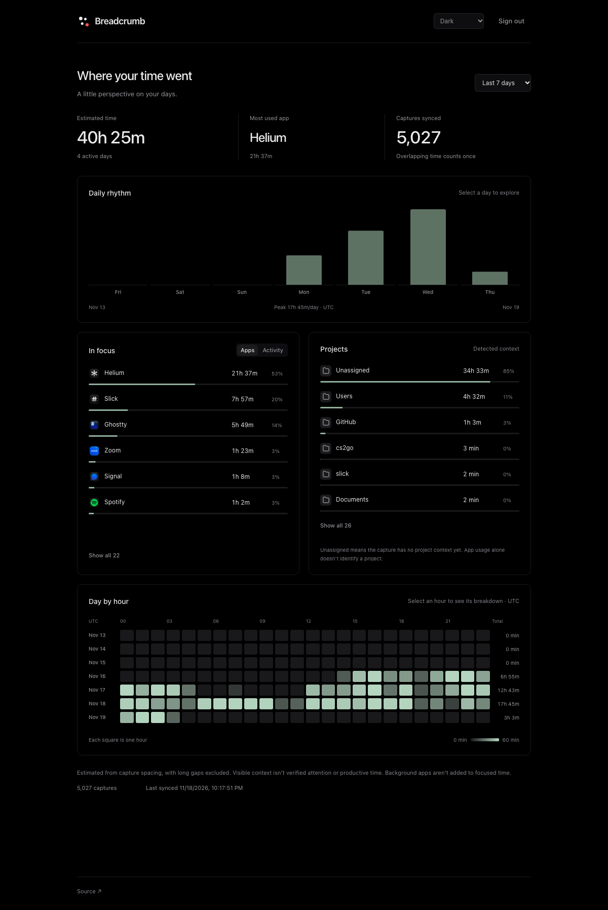
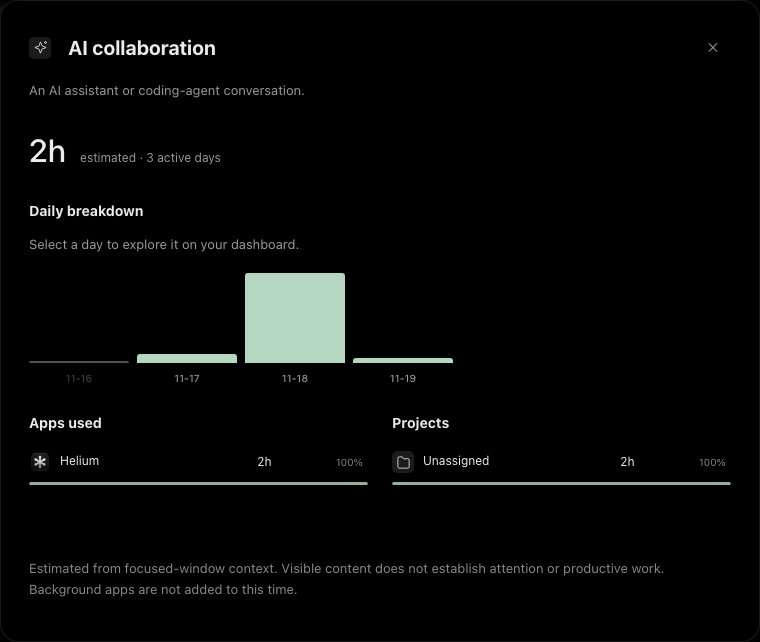

<p align="center"></p>

<h1 align="center">Breadcrumb</h1>
<p align="center">A little context goes a long way.</p>
<p align="center">A passive desktop history that helps you understand where your time went.</p>
<p align="center"><a href="https://breadcrumb.hackclub.com/download">Download</a> · <a href="https://breadcrumb.hackclub.com">Web portal</a> · <a href="docs/development.md">Development</a> · <a href="web/README.md">Self-hosting</a> · <a href="LICENSE">AGPLv3</a></p>



## Your day, in context

Breadcrumb stays in your menu bar or system tray and records the display containing your focused window. Your history and full time dashboard work offline, without an account. Connect to a portal when you want them available across devices.

- **See where time went.** Explore daily and hourly patterns, apps, activities, and project context.
- **Keep momentum.** Build time separates making from messaging and video, with a daily streak, a weekly recap, and how much of it was spent in AI conversations. Capture pauses when you step away.
- **Go deeper.** Open an activity to see its daily breakdown, contributing apps, and projects. Categories include coding, debugging, testing, code review, research, AI collaboration, design, and writing.
- **Keep the whole picture.** Focused and alongside context stay separate. A chat with an AI and a video visible beside it can coexist without counting the same minute twice.
- **Stay lightweight.** Nearly unchanged screenshots share one image. Uploads reuse acknowledged images, with adjustable concurrency, progress, and an ETA.
- **Make it yours.** Dark, light, and Catppuccin themes; configurable cadence, retention, storage, OCR, and app exclusions.
- **Choose what is public.** Reserve a username, keep your profile public or private, and choose which apps to share. Capture history stays off your public profile.
- **Stay up to date.** Check automatically every four hours and install signed updates when you are ready. See [desktop updates](docs/updates.md).
- **Bring your agents.** Editable Python rules and an agent review protocol make labeling extensible.



_Screenshots use the maintainer’s real capture history. Time is estimated from capture spacing and focused-window context; it is not verified attention or productive work._

## Local first, optional sync

Recording needs no account. History is stored as plain JSON and JPEG files on your computer. Breadcrumb records no audio or keystrokes. Screenshots and visible window context can contain private information; review your exclusions and capture settings.

To sync, open **Settings → Account**, enter your portal URL, and sign in through your browser. Approving the connection uploads all existing and future captures, including screenshots and captured text/tree context. Signing out stops uploads. Deleting local history does not delete captures already synced.

You can run your own portal. Authentication uses Better Auth and PostgreSQL; capture storage uses private S3-compatible R2. No Hack Club account is required. See [desktop behavior and privacy](docs/desktop.md) and [hosting setup](web/README.md).

## Platforms

| Platform | Capture and context                          | Requirements                                             |
| -------- | -------------------------------------------- | -------------------------------------------------------- |
| macOS    | ScreenCaptureKit, Accessibility, local OCR   | macOS 14+, Intel or Apple Silicon                        |
| Windows  | Native display capture, UI Automation        | x64; see [Windows setup and validation](docs/windows.md) |
| Linux    | X11 capture + AT-SPI; Wayland portal sharing | See [Linux setup and limitations](docs/linux.md)         |

Wayland supports native window context and exclusions on supported desktops. Select displays in Settings → Privacy; see the Linux guide for setup and fallback behavior.

Accessibility is optional on macOS. Windows does not yet provide local OCR. Linux includes local English OCR. See [macOS installation and packaging](docs/macos.md) for Mac downloads and signing. Windows publisher signing remains separate from verified update signatures.

## Run locally

Install **Bun 1.4.4**, **Go 1.26+**, **Python 3**, and **stable Rust**, plus your platform’s native build dependencies. macOS also needs a recent Xcode toolchain.

```sh
bun install --frozen-lockfile
bun install --cwd desktop --frozen-lockfile
bun install --cwd web --frozen-lockfile
python3 scripts/desktop-prepare.py
bun run --cwd desktop tauri dev
```

For a UI preview with synthetic data, run `bun run --cwd desktop dev`. To build a native app, run `bash scripts/desktop-build.sh`.

The monorepo contains a Tauri/React desktop, a local Go engine, native capture adapters, a Next.js portal/API, and Python agent tools. See the [development guide](docs/development.md) for checks and build details, or the [agent protocol](agents/REVIEWING.md) to integrate a reviewer.

## License

[GNU AGPLv3](LICENSE) · `AGPL-3.0-only`
